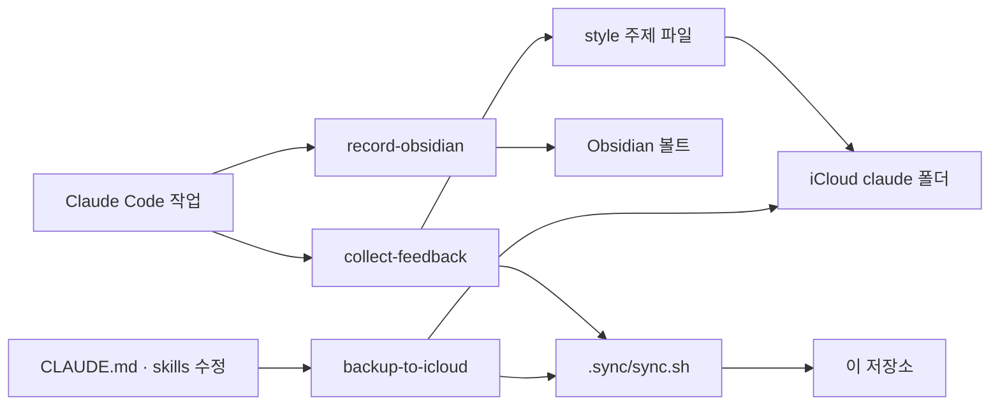

# MY-CLAUDE-SKILL

Claude Code 를 쓰면서 쌓은 전역 지침, 스킬, 스타일 규칙을 모아 둔 저장소다. 원본은 iCloud 의 `claude` 폴더이고, 이 저장소는 그 폴더를 자동으로 복사해 커밋한 사본이다.

## 구성

| 경로 | 내용 |
|---|---|
| `CLAUDE.md` | 모든 프로젝트에 적용하는 전역 지침. 스타일 색인 읽는 법, 피드백 수집 규칙, iCloud 백업 규칙, 시스템 사전(Obsidian) 안내 |
| `skills/` | 직접 만든 Claude Code 스킬 |
| `style/` | 내 작업 방식과 코드 스타일 규칙. 색인 하나와 주제별 파일 |
| `skills-backup/` | 예전 스킬 백업 |
| `dance.sh` | `dance` 스킬이 쓰는 터미널 애니메이션 스크립트 |
| `.sync/` | iCloud 폴더를 이 저장소로 복사하고 커밋하는 스크립트 |

## 스킬을 쓰는 방식

| 스킬 | 언제 쓰나 | 하는 일 | 왜 만들었나 |
|---|---|---|---|
| `jira` | `/jira OMS-1234` 로 티켓 작업을 시작할 때 | 티켓 분석 → 계획 확인 → 단위 테스트 먼저 작성 → 구현 순서로 진행한다 | |
| `collect-feedback` | 작업이 끝났거나 칭찬·지적을 했을 때 | 대화에서 내가 준 피드백을 골라 `style/` 의 주제 파일에 규칙으로 반영하고 색인을 갱신한다 | |
| `record-obsidian` | "기록해줘" 라고 할 때 | 대화를 Obsidian 볼트의 날짜별 기록에 남기고, 코드로 확인한 사실을 시스템 사전에 반영한다 | |
| `collect-worklog` | `/collect-worklog 20260421` 처럼 날짜를 줄 때 | 그날 Slack 대화에서 들어온 업무를 모아 Notion Work Log 에 정리한다 | |
| `pr-summary` | "PR 에 공유하게 정리해줘" 라고 할 때 | 수정한 변경을 이슈 → 원인 → 작업 내용 → 영향 순서의 짧은 마크다운으로 정리한다 | |
| `backup-to-icloud` | `CLAUDE.md` 나 스킬을 고쳤을 때 | 바뀐 설정을 iCloud `claude` 폴더로 복사한다 | |
| `dance` | `/dance` 또는 기분을 말할 때 | 기분에 맞는 ASCII 춤 애니메이션을 보여 준다 | |

정확한 호출 조건은 각 스킬 `SKILL.md` frontmatter 의 `description` 이 기준이다. 이 표의 '언제 쓰나' 는 요약이다.

## 스타일 규칙을 쓰는 방식

- 세션을 시작하면 Claude 는 `style/index.md` 만 읽는다. 색인에는 읽는 법, 자주 반복한 피드백의 우선순위, 작업별로 읽을 파일 표가 있다.
- 주제 파일(`style/code/*.md`, `style/work/*.md`)은 지금 하는 작업에 필요한 것만 읽는다. 어느 파일을 읽을지 애매하면 작업 전에 나에게 묻는다.
- 규칙은 손으로 쓰지 않고 `collect-feedback` 스킬이 대화에서 모아 반영한다. 같은 지적을 여러 번 하면 기존 규칙에 보강으로 쌓이고 우선순위가 올라간다.
- 주제 파일이 20KB 를 넘으면 압축하지 않고 파일을 나눈다.

## 흐름

## 자동 동기화

- iCloud `claude` 폴더를 바꾸는 두 곳이 끝날 때 `.sync/sync.sh` 를 실행한다: `collect-feedback` 스킬(스타일 반영 뒤), iCloud 백업(`CLAUDE.md`·스킬 복사 뒤, `backup-to-icloud` 스킬과 `CLAUDE.md` 의 백업 규칙). 손으로 고친 것은 다음 실행 때 함께 올라가고, 바로 올리려면 스크립트를 직접 실행한다.
- 스크립트는 iCloud `claude` 폴더를 이 저장소로 복사하고, 바뀐 파일이 있을 때만 커밋하고 push 한다.
- `.sync/exclude.txt` 에 적은 파일은 복사하지 않는다(`security.md`, `style-archive/`, `.DS_Store`, `*.env` 등). `style-archive/` 는 압축 전 원본이라 회사 업무 내용이 남아 있어 올리지 않는다.
- 비밀값으로 보이는 내용이 새로 들어오면 커밋하지 않고 `.sync/sync.log` 에 남긴다.
- 이 저장소에서 직접 고친 내용은 다음 동기화 때 iCloud 내용으로 덮인다. 고칠 때는 원본을 고친다. `README.md`, `.gitignore`, `.sync/` 는 덮이지 않는다.
