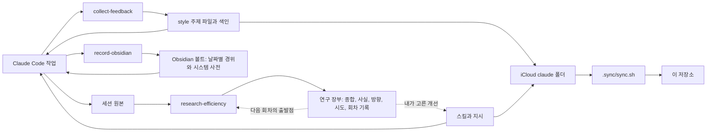

# MY-CLAUDE-SKILL

Claude Code 를 쓰면서 쌓은 전역 지침, 스킬, 스타일 규칙을 모아 둔 저장소다. 원본은 iCloud 의 `claude` 폴더이고, 이 저장소는 그 폴더를 자동으로 복사해 커밋한 사본이다.

## 구성

| 경로 | 내용 |
|---|---|
| `CLAUDE.md` | 모든 프로젝트에 적용하는 전역 지침. 스타일 색인 읽는 법, 피드백 수집 규칙, iCloud 백업 규칙, 시스템 사전(Obsidian) 안내 |
| `skills/` | 직접 만든 Claude Code 스킬. 아래 '스킬' 에서 하나씩 설명한다 |
| `style/` | 내 작업 방식과 코드 스타일 규칙. 색인 하나와 주제별 파일 |
| `skills-backup/` | 2026-08-21 에 떠 둔 예전 스킬 사본 |
| `record-backup/` | 2026-11-16 에 기록 노트의 형식을 바꿀 때 쓴 1회용 변환 도구 |
| `.sync/` | iCloud 폴더를 이 저장소로 복사하고 커밋하는 스크립트 |

## 스킬

스킬마다 무엇인지, 왜 필요했는지, 무엇을 이루려는지, 그 목적까지 가는 단계와 단계마다 나오는 결과물을 적는다. 정확한 호출 조건은 각 스킬 `SKILL.md` 의 frontmatter 가 기준이다.

| 스킬 | 하는 일 | 부르는 때 |
|---|---|---|
| [`jira`](#jira) | 티켓 번호 하나로 분석, 계획, 단위 테스트, 구현까지 간다 | `/jira OMS-1234` |
| [`pr-summary`](#pr-summary) | 고친 내용을 이슈, 원인, 작업 내용, 영향으로 짧게 정리한다 | "PR 에 공유하게 정리해줘" |
| [`collect-worklog`](#collect-worklog) | 그날 Slack 에서 들어온 일을 모아 Notion Work Log 에 적는다 | `/collect-worklog 20260421` |
| [`collect-feedback`](#collect-feedback) | 대화에서 내가 준 피드백을 스타일 규칙으로 쌓는다 | 작업이 끝났거나 칭찬·지적을 했을 때 |
| [`record-obsidian`](#record-obsidian) | 대화의 경위와 확인한 시스템 사실을 Obsidian 볼트에 남긴다 | "기록해줘" |
| [`research-efficiency`](#research-efficiency) | 지시와 반복 절차의 효율을 연구하는 연구실. 회차마다 지난 결과에서 이어서 재고, 알게 된 것을 장부에 쌓는다 | `/research-efficiency 초점` |
| [`backup-to-icloud`](#backup-to-icloud) | 설정과 스킬을 iCloud 로 복사한다 | 지금은 전역 지침의 백업 규칙이 대신한다 |

### jira

- **무엇:** Jira 티켓 번호를 받아 티켓 분석, 작업 계획, 단위 테스트, 구현 순서로 진행하는 작업 절차다.
- **필요했던 이유:** 티켓 작업은 매번 같은 순서로 가야 한다. 순서를 정해 두지 않으면 계획을 확인받기 전에 구현부터 하거나, 테스트를 구현 뒤로 미루거나, 티켓 범위 밖까지 고치는 일이 생긴다.
- **목적:** 티켓의 요구사항을 내가 확인한 계획대로, 단위 테스트가 받치는 코드로 구현한다. 커밋은 스킬이 하지 않고 내가 한다.

| 단계 | 하는 일 | 나오는 결과물 |
|---|---|---|
| 1. 티켓 분석 | 티켓, 연결된 이슈와 문서, 프로젝트의 관련 문서를 읽는다 | 요구사항 정리 |
| 2. 작업 계획 | 영향 범위와 기존 코드를 보고 단위 테스트 대상을 고른다 | 테스트가 구현보다 앞에 오는 작업 목록. 내가 확인해야 다음으로 간다 |
| 3. 단위 테스트 | 구현 전에 테스트를 쓴다 | 컴파일은 되고 실패하는 테스트 |
| 4. 구현 | 테스트가 통과하도록 구현한다 | 구현 코드, 빌드와 테스트 결과 |

### pr-summary

- **무엇:** 고친 변경을 이슈, 원인, 작업 내용, 영향 네 주제의 짧은 마크다운으로 정리한다.
- **필요했던 이유:** PR 본문이나 팀 공유 글을 대화 기억으로 쓰면 실제 변경과 어긋난다. 확인한 것과 추론한 것이 섞이고, 리뷰어가 걱정하는 '바뀌지 않는 것' 이 빠진다.
- **목적:** 리뷰어가 한 화면에서 무엇이 문제였고, 왜 생겼고, 무엇을 바꿨고, 무엇이 그대로인지 알게 한다.

| 단계 | 하는 일 | 나오는 결과물 |
|---|---|---|
| 1. 사실 모으기 | 변경은 실제 diff 로 확인하고, 바뀐 코드의 호출처와 조건을 다시 따라간다 | 변경 목록, 실측과 추론을 가른 진단, 달라지는 것과 그대로인 것 |
| 2. 작성 | 정해 둔 틀에 주제마다 1~4줄로 쓴다 | 이슈, 원인, 작업 내용, 영향 네 주제의 글 |
| 3. 전달 | 붙여넣기 쉽게 낸다 | 마크다운 코드 블록 하나. PR 생성이나 전송은 내가 요청할 때만 한다 |

### collect-worklog

- **무엇:** 날짜를 주면 그날의 Slack 메시지를 분석해 Notion Work Log 의 그 날짜에 들어온 일을 정리한다.
- **필요했던 이유:** 하루 동안 들어온 일은 Slack 의 여러 채널과 스레드에 흩어져 있다. 나중에 무슨 일을 어떻게 처리했는지 찾기 어렵고, 손으로 옮기면 빠지거나 날마다 형식이 달라진다.
- **목적:** 그날 처리한 업무를 일 단위로 남긴다. 누가 제보했고, 원인이 무엇이었고, 어떻게 대응해 어떻게 끝났는지를 링크와 함께 적는다.

| 단계 | 하는 일 | 나오는 결과물 |
|---|---|---|
| 1. Slack 검색 | 그날 내가 쓴 메시지와 나를 멘션한 메시지를 찾는다 | 그날의 업무 메시지 |
| 2. 메시지 분석 | 일마다 내용을 뽑고, 같은 일은 스레드가 달라도 하나로 묶는다 | 일마다 제보자, 배경, 원인, 대응, 결과, 링크, 추적할 식별자 |
| 3. Notion 확인 | Work Log 페이지에서 그 날짜를 찾는다 | 그 날짜의 토글. 없으면 템플릿으로 만든다 |
| 4. 작성 | '들어온 일' 에만 쓰고 다른 구역은 건드리지 않는다 | 일마다 토글 하나. 요약 한 문장과 번호를 단 처리 과정 |

### collect-feedback

- **무엇:** 대화에서 내가 준 피드백(금지, 수정 요청, 작업 방식, 스타일 선호, 칭찬)을 골라 `style/` 의 주제 파일에 규칙으로 반영하고 색인을 고친다. 대화와 분리된 맥락에서 돈다.
- **필요했던 이유:** 세션이 바뀌면 Claude 는 앞 세션에서 받은 지적을 모른다. 규칙을 손으로 적어 두면 빠지는 것이 생기고, 한 파일에 계속 쌓으면 매번 읽는 양이 커진다.
- **목적:** 한 번 한 지적과 칭찬이 다음 세션부터 지켜지게 한다. 규칙이 늘어도 세션은 지금 작업에 필요한 파일만 읽는다.

| 단계 | 하는 일 | 나오는 결과물 |
|---|---|---|
| 1. 대화 스캔 | 피드백에 해당하는 내 발언을 모두 찾는다 | 피드백 발언 목록 |
| 2. 분류와 검색 | 그 규칙이 읽혀야 하는 작업으로 주제 파일을 고르고, 비슷한 기존 규칙을 찾는다 | 들어갈 파일과 합칠 후보 |
| 3. 반영 | 기존 규칙에 합치는 것을 먼저 하고, 맞는 것이 없을 때만 새로 쓴다 | 보강한 규칙이나 새 규칙(제목, 무엇, 왜) |
| 4. 색인 갱신 | 도구로 색인을 다시 만든다 | `style/index.md` 의 파일 목록과 우선순위 수치 |
| 5. 동기화와 보고 | 이 저장소로 올리고 결과를 알린다 | 커밋, 파일별 반영 표, 파일 크기, 분류한 근거, 내 승인이 필요한 제안 |

### record-obsidian

- **무엇:** 대화를 Obsidian 볼트에 남긴다. 날짜별 기록에는 경위를, 시스템 사전에는 코드로 확인한 지금의 사실을 쓴다. 본 대화는 날짜별 기록과 넘김 글만 쓰고, 사전은 새 맥락의 서브에이전트가 고친다.
- **필요했던 이유:** 끝난 작업의 경위(왜 그렇게 정했는가)와 그때 확인한 시스템 사실은 세션이 끝나면 사라진다. 다음 세션은 같은 것을 다시 조사하거나 낡은 기억으로 답한다.
- **목적:** 다음 세션이 볼트에서 지난 작업의 경위와 지금 참인 시스템 사실을 찾아 쓰게 한다. 동작 사실은 대화의 서술이 아니라 코드로 확인해 적는다.

| 단계 | 하는 일 | 나오는 결과물 |
|---|---|---|
| 1. 시작 | 시작 도구를 한 번 돌린다 | 오늘 날짜, 기록 규칙 전문, 열린 제안, 오늘 노트의 주제 목록, 세션 타임라인 |
| 2. 날짜별 기록 | 규칙대로 쓰고, 오늘 노트가 있으면 합친다 | 날짜 노트의 주제(경위, 결정, 결과와 상태), 날짜별·시스템별 가이드의 줄 |
| 3. 넘김 글 | 서브에이전트가 대화를 못 보므로 필요한 것을 뽑아 적는다 | 주제마다 찾을 열쇠, 사실과 그 갈래(코드 사실, 정책, 예외, 보완, 확인 사항), 내 판단, 상태 |
| 4. 사전 갱신 | 서브에이전트가 코드와 대조해 사전을 고치고 점검한다 | 고친 사전 노트, 지도, 검진 결과, 점검 도구의 차단 0 |
| 5. 보고 | 단계마다 한 일을 모은다 | 고친 파일 표, 정리한 제안, 내가 판단할 확인 사항 |

### research-efficiency

- **무엇:** 대화가 참고하는 지시(전역 지침, 스타일, 스킬, 메모리, 볼트 규칙)와 반복 절차(기록, 피드백 수집, 워크로그)의 효율을 연구하는 연구실이다. 효율은 품질을 지키면서 드는 토큰과 값을 줄이는 것이다. 스킬을 한 번 부르는 것이 한 회차이고, 한 회차는 초점 하나만 다룬다. 닫기 전에는 연구실 자신(방향, 기록, 이 스킬)도 검증해 고친다.
- **필요했던 이유:** 지시와 기록 절차는 계속 늘어난다. 무엇이 얼마나 드는지 재지 않으면 어디를 줄일지 알 수 없다. 연구 결과도 계속 쌓이는데, 한 파일에 덧붙이기만 하면 다음 연구가 지난 결과를 찾아 쓰지 못한다.
- **목적:** 회차마다 지난 회차가 쌓은 장부에서 시작하고, 알게 된 것을 다음 회차가 찾아 쓸 자리에 쌓아, 연구할수록 더 나은 결과를 낸다.

| 단계 | 하는 일 | 나오는 결과물 |
|---|---|---|
| 1. 시작 | 스킬을 부르면 도구가 낸 현황과 종합이 본문에 끼워져 나온다 | 쌓인 것, 지난 회차의 인계, 판정을 기다리는 시도, 열린 방향, 지금 아는 것(`knowledge.md`) |
| 2. 옮기기 | 지난 회차 뒤의 스킬 실행을 세션 원본에서 잰다. 원본은 30일 뒤 지워진다 | 실행마다 호출 수, 맥락 크기, 종류별 토큰, 값(`runs.tsv`, `base.tsv`) |
| 3. 초점 정하기 | 내가 준 것, 횟수가 찬 시도, 우선이 높은 방향 순으로 하나를 고른다 | 이번 회차의 초점. 나머지는 다음에 할 일로 넘긴다 |
| 4. 선행 연구 확인 | 초점의 핵심어로 지난 사실, 방향, 시도를 찾아 읽는다 | 이번에 쓸 항목의 근거에 달 선행 번호. 이미 잰 것은 다시 재지 않는다 |
| 5. 연구 | 판정(시도의 전후 값을 미리 적은 기준과 견준다), 탐색(큰 항목부터 잰다), 적용(바꾸기 전에 사전 측정과 예측을 적는다), 종합 가운데 하나를 한다 | 판정 결과, 잰 값, 또는 사전 측정·예측·판정 기준이 달린 시도 |
| 6. 쌓기 | 알게 된 것을 항목 하나에 파일 하나로 쓰고 종합을 고친다 | 사실(`findings/F-번호.md`), 방향(`directions/D-번호.md`), 시도(`attempts/A-번호.md`), 고친 `knowledge.md` |
| 7. 검증과 발전 | 닫기 전에 방향, 기록, 이 스킬이 지금도 맞는지 이번 회차에서 겪은 것으로 확인한다. 고칠 수 있는 것은 그 자리에서 고친다 | 고친 방향 상태·사실·종합 문장, 고친 도구와 본문의 틀린 서술, 내가 고를 연구실 방향(스킬의 순서나 형식을 바꾸자는 제안) |
| 8. 닫기 | 장부 점검을 통과하고 7단계의 세 답(방향, 기록, 스킬)이 있어야 닫힌다. 이 회차에 든 값도 잰다 | 회차 기록 한 줄(`log.tsv`: 초점, 한 일, 검증한 답, 다음에 할 일, 든 값)과 목록(`index.md`) |
| 9. 보고 | 초점과 결론, 새로 쌓은 것, 내가 정할 것을 보고한다 | 보고. 어느 방향을 시도할지는 내가 고른다 |

### backup-to-icloud

- **무엇:** 전역 지침과 스킬 폴더를 iCloud 백업 폴더와 맞추고 이 저장소로 올린다.
- **필요했던 이유:** 설정과 스킬은 한 컴퓨터의 `~/.claude` 에만 있어 잃으면 되돌릴 수 없다.
- **목적:** 고칠 때마다 사본을 두어 언제든 되돌릴 수 있게 한다.
- **지금:** 같은 일을 전역 `CLAUDE.md` 의 'iCloud 백업 규칙' 이 한다. 이 스킬은 iCloud 사본으로만 남아 있다.

| 단계 | 하는 일 | 나오는 결과물 |
|---|---|---|
| 1. 변경 탐지 | 로컬과 iCloud 를 견준다 | 무엇이 다른지 요약 |
| 2. 복사와 검증 | 바뀐 것만 복사하고 다시 견준다 | 원본과 같은 iCloud 사본 |
| 3. 동기화 | 동기화 스크립트를 돌린다 | 이 저장소의 커밋 |

## 스킬이 잇는 흐름

## 스타일 규칙을 쓰는 방식

- 세션을 시작하면 Claude 는 `style/index.md` 만 읽는다. 색인에는 읽는 법, 자주 반복한 피드백의 우선순위, 작업별로 읽을 파일 표가 있다.
- 주제 파일(`style/code/*.md`, `style/work/*.md`)은 지금 하는 작업에 필요한 것만 읽는다. 어느 파일을 읽을지 애매하면 작업 전에 나에게 묻는다.
- 규칙은 손으로 쓰지 않고 `collect-feedback` 스킬이 대화에서 모아 반영한다. 같은 지적을 여러 번 하면 기존 규칙에 보강으로 쌓이고 우선순위가 올라간다.
- 주제 파일이 20KB 를 넘으면 압축하지 않고 파일을 나눈다.

## 자동 동기화

- iCloud `claude` 폴더를 바꾼 뒤에 `.sync/sync.sh` 를 실행한다. `collect-feedback` 스킬은 스타일을 반영한 뒤에, 그 밖에는 전역 `CLAUDE.md` 의 백업 규칙에 따라 지침이나 스킬을 iCloud 로 복사한 뒤에 실행한다. 손으로 고친 것은 다음 실행 때 함께 올라간다.
- 스크립트는 iCloud `claude` 폴더를 이 저장소로 복사하고, 바뀐 파일이 있을 때만 커밋하고 push 한다.
- `.sync/exclude.txt` 에 적은 파일은 복사하지 않는다(`security.md`, `style-archive/`, 이름에 `private` 이 든 것, `*.env`, `*.tgz`·`*.zip` 같은 묶음 파일, `__pycache__` 등). 회사 업무 내용이 남은 것은 올리지 않는다.
- 비밀값으로 보이는 내용이 새로 들어오면 커밋하지 않고 `.sync/sync.log` 에 남긴다. 바이너리 파일은 내용을 검사할 수 없으므로 새로 들어오면 마찬가지로 커밋하지 않고 멈춘다.
- 볼트 노트와 회사 자료, 그 사본과 묶음은 iCloud `claude` 폴더에 두지 않는다. 그 폴더에 둔 것은 모두 이 저장소로 올라간다.
- 이 저장소에서 직접 고친 내용은 다음 동기화 때 iCloud 내용으로 덮인다. 고칠 때는 원본을 고친다. `README.md`, `.gitignore`, `.sync/` 는 덮이지 않는다.

## 이 문서를 고치는 때

스킬을 더하거나 지웠거나, 스킬이 하는 일이나 단계나 결과물이 달라졌으면 올리기 전에 이 문서의 그 스킬 절과 구성 표를 고친다. 규칙은 전역 `CLAUDE.md` 의 'iCloud 백업 규칙' 에 있다. 마지막으로 스킬과 맞춘 날은 2026-11-17 이다.
