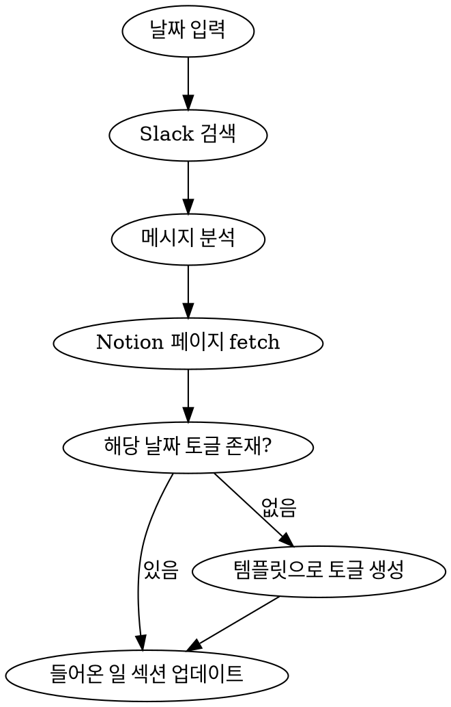

# Collect Work Log

Slack 메시지를 분석하여 Notion Work Log 의 해당 날짜 토글에 들어온 일을 정리한다.

## 사용 방법

```
/collect-worklog 20260421          # 2026년 4월 21일 들어온 일 정리
/collect-worklog 20260421 미팅      # 특정 섹션 지정
```

자연어 요청도 가능하나, `/collect-worklog`가 가장 확실한 호출 방법이다.

## 입력

| 파라미터 | 설명 | 예시 |
|----------|------|------|
| 날짜 | YYYYMMDD (KST 기준) | `20260421` |
| 섹션 | 작성할 섹션 (기본: 들어온 일) | `들어온 일` |

## 날짜 규칙

- 날짜 기준은 **항상 한국 시간(KST, UTC+9)**
- 명시된 날짜의 KST 24시간(00:00~23:59)을 슬랙 검색 범위로 사용
- **슬랙 데이터를 해당 날짜의 노션 토글에 작성** (다른 날짜 토글에 쓰지 않음)

## Notion Work Log

- 페이지: `https://www.notion.so/2026-Work-Log-2e3bdf641e4c8041860afcb846d68735`
- 각 날짜는 `<details><summary><mention-date start="YYYY-MM-DD"/></summary>` 토글로 관리
- 토글 내부 구조: 해야할 일 / 들어온 일 / 미팅 / 이슈 / 공부 / 회고
- 해당 날짜 토글이 없으면 버튼 템플릿으로 생성: `#2e3bdf641e4c80019b09fb80f0da9e3d`

## 실행 절차



### 1. Slack 검색

- 현재 사용자(U0846K7FVPD)의 메시지를 검색: `from:<@U0846K7FVPD> on:YYYY-MM-DD`
- 사용자를 멘션한 메시지도 검색: `to:<@U0846K7FVPD> on:YYYY-MM-DD`
- 결과가 크면 Agent를 사용하여 분석 위임

### 2. 메시지 분석

Agent에게 위임하여 각 이슈별로 추출:

| 항목 | 설명 |
|------|------|
| 제보자 | 누가 이슈를 제기했는지 (직책+님 경칭). 본인이 자체 발견한 경우 "본인 발견" / "본인 주도" 명시 |
| 배경 | 왜 이 이슈가 발생했는지 |
| 원인 | 근본 원인 |
| 대응 | 사용자가 어떻게 처리했는지 (타임라인) |
| 결과 | 현재 상태, 후속 조치 |
| 링크 | Slack permalink |
| 핵심 디테일 | 주문번호, 에러 메시지, Jira 티켓 등 |

**제외 대상:** 인사, 점심, 워크샵 등 비업무 메시지, 봇 알림(사용자가 직접 응답하지 않은 것)

**포함 대상 보강:**
- 외부 제보뿐 아니라 **본인이 자체 발견한 이슈/정리 작업**도 들어온 일에 포함 (graylog 알림 직접 대응, 전일 협의된 후속 작업 실행 안내 등)
- "들어온 일" 은 외부 제보만이 아니라 **그날 처리한 업무 단위** 를 의미

### 2-1. 동일 root cause 이슈 병합 — case 단위 판단

병합/분리는 **root cause 추상화 레벨이 아닌 case 단위** (주문번호/식별자/협의 단위) 로 판단한다.

**같은 case → 통합 (thread/채널 달라도)**
- 메인 thread (PM 협의 thread, 외부 요청 thread 등) 를 **대표 슬랙 링크**로 사용
- 나머지 케이스(주문번호, pickupNo, 다른 thread 처리 결과 등) 는 타임라인 항목으로 추가
- 본인이 graylog 알림에 회신한 것도 같은 case 의 외부 응대와 연결되면 통합 (예: graylog 404 처리 → 그 결과를 고객 영문 응대로 보고하는 경우 단일 토글)

**다른 case → 분리 (root cause 같아 보여도)**
- root cause 카테고리가 같아도 case (협의 thread / 개별 주문 / 정책 논의) 가 다르면 별도 토글
- 예: "LXP 검수결과 미수신" root cause 가 비슷한 3개 case (3/25 173건 정책 협의 / 개별 주문 환불 / 판토스 출고 메일 대기) → 각각 별도 토글

**예시:**
- 2026-05-12 — Jackie Flores 철회된 반품 번호 인입 이슈 + graylog 알림 매핑 3건을 단일 토글로 통합 (같은 case)
- 2026-05-22 — graylog GM-OMS 반품 요청 404 (RT823237293679480783) + Jackie Flores 환불 영문 응대를 단일 토글로 통합 (같은 주문 환불 case)
- 2026-05-22 — LXP 검수결과 미수신 root cause 가 비슷한 3건은 case 가 달라 각각 별도 토글

### 3. Notion 업데이트

해당 날짜 토글의 `들어온 일` 섹션을 업데이트한다.

## 작성 포맷

각 이슈를 **토글(details/summary)** 로 작성:

```
<details>
<summary>[이슈 요약 한 문장] ([제보자]). ([슬랙](permalink))</summary>
  1. [첫 번째 단계 — 누가 무엇을 제보/요청]
  2. [원인 확인 내용]
  3. [대응 조치]
  4. [결과/현재 상태]
</details>
```

### 작성 규칙

- **요약**: 누가 봐도 이해할 수 있는 서술형 한 문장 (아마존 내러티브 스타일)
- **타임라인**: 번호(1, 2, 3...)로 순차 처리 과정 기록
- **사람 이름**: 한국인은 직책+님 (예: 김민석(QA)님, 물류기획팀(강지혜 팀장님))
- **슬랙 링크**: 괄호로 감싸기 `([슬랙](url))`
- **핵심 디테일**: 주문번호, 에러 메시지, Jira 티켓 등 추적 가능한 정보 포함

## Notion 인덴테이션

페이지 내 토글 위치에 따라 탭 레벨이 다르므로, 반드시 현재 페이지를 fetch하여 기존 인덴테이션을 확인한 후 작성한다.

## old_str anchor 전략 (중요)

`update_content` 의 `old_str` 은 **반드시 토글 경계까지 포함**한다. 섹션 내부의 짧은 패턴(예: `- 들어온 일\n\t\t\t\t-\n\t\t\t- 미팅`)만 사용하면 큰 페이지(80KB+)에서 Notion 매칭 엔진 타임아웃이 반복 발생한다.

**올바른 anchor 형태:**
```
\t\t\t- 들어온 일
\t\t\t\t-
\t\t\t- 미팅
\t\t\t- 이슈
\t\t\t- 공부
\t\t\t- 회고
\t\t</details>
\t\t<details>
\t\t<summary><mention-date start="YYYY-MM-DD-1"
```

대상 날짜 토글의 끝(`</details>`)부터 다음 토글의 시작(`<details>...summary><mention-date start="...`)까지 포함하여 매칭한다. 이렇게 하면 anchor가 페이지 내 유일하게 식별 가능하고 Notion이 즉시 처리한다.

`new_str` 도 동일한 끝 경계를 그대로 유지(replace 후에도 다음 토글 구조 보존).

## 타임아웃 발생 시 대처

페이지가 100KB 이상으로 커지면 토글 경계 anchor 도 timeout 날 수 있다. 다음 순서로 진단/조치한다.

1. **동시 편집 흔적 점검** — 직전 fetch 결과와 비교하여 사용자가 추가한 텍스트(회고/새 토글 등) 가 있는지 확인. 흔적이 있으면 사용자가 Notion 탭을 열어둔 상태일 가능성
2. **사용자에게 탭 닫기 요청** — 동시 편집 의심 시 사용자에게 Notion 탭을 닫아달라고 안내. 닫은 후 같은 anchor 재시도
3. **anchor 단계적 축소 (중요)** — 토글 경계 anchor (다음 토글 시작까지) 가 계속 실패하면, **같은 토글 내부의 unique 라인** 까지의 짧은 anchor 로 전환:
   ```
   \t\t\t- 들어온 일
   \t\t\t\t-
   \t\t\t- 미팅
   \t\t\t\t- 09:00-09:30 \\| <같은 날 unique 미팅 제목>
   ```
   같은 날 미팅 시간/제목 라인이 페이지 내 unique 하면 즉시 매칭됨. 토글 경계 anchor 보다 짧고 빠를 수 있다.
4. **캐시 워밍업** — 짧은 anchor + 매우 작은 변경 (예: 미팅 라인 끝에 trailing space 1개 추가) 으로 1회 update 통과시켜 매칭 엔진 캐시 데우기. 이후 본 update 재시도
5. **토글 분할 추가 (중요, 5/27 보강)** — 여러 토글을 한 번에 추가하면 **content 길이 자체가 timeout 의 원인** 이 된다. anchor 짧아도 content 가 길면 timeout. 한 번에 **1개 토글씩 분할 추가**:
   - 첫 토글: 기존 `- 들어온 일 / - / - 미팅 / - 미팅시간` anchor 사용
   - 두 번째 토글부터: **직전 토글의 마지막 라인 + `</details>` + `- 미팅` + `- 미팅시간`** 을 anchor 로 사용
   - 5건 토글이면 5번 호출. 각 호출은 1.5KB 이하 content 라 안정적으로 통과
   - 예: 5/26 work log 5건 작성 시 한 번에 추가 → 4회 timeout / 1개씩 분할 → 5회 모두 성공

**anchor 가 unique 한지 확인:** 같은 패턴이 다른 날 토글에도 있는지 체크. 미팅 시간 + 미팅 제목이 그날만의 unique 한 조합인 경우에 짧은 anchor 안전. 직전 토글 마지막 라인은 그날만의 unique 한 처리 결과라 분할 추가 시 anchor 충돌 거의 없음

## 주의사항

- Notion이 Slack URL을 `slackMessage://` 형식으로 변환하므로, 수정 시 변환된 URL로 매칭해야 함
- 기존 들어온 일 내용이 있으면 대체하되, 다른 섹션(해야할 일, 미팅 등)은 절대 건드리지 않음
- 페이지가 크므로 fetch 결과를 파일로 저장하고 grep/python으로 필요한 부분만 추출
