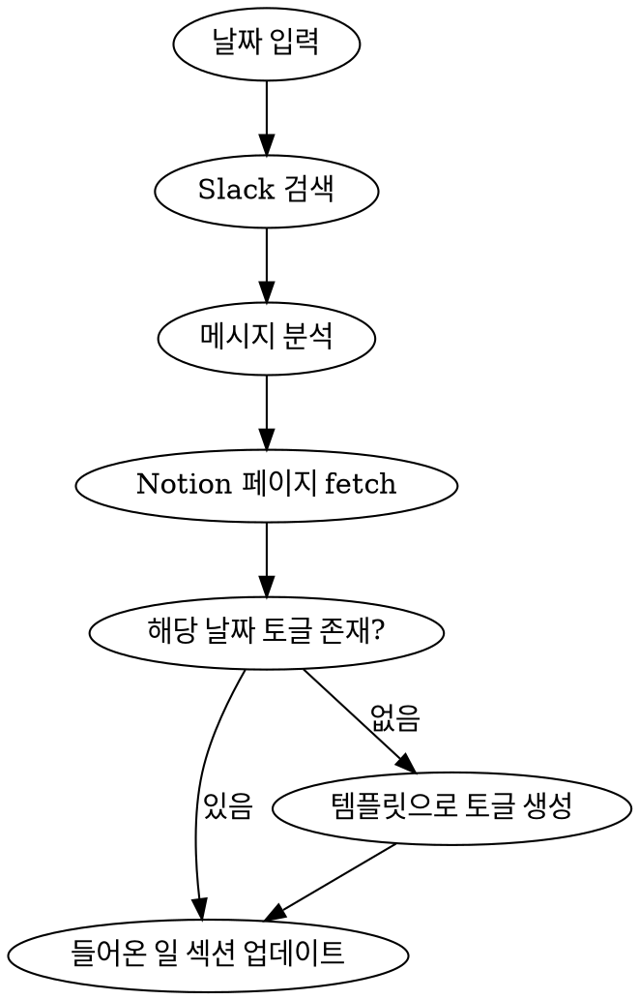

# Collect Work Log

Slack 메시지를 분석하여 Notion Work Log 의 해당 날짜 토글 '들어온 일' 에 **그날 내가 처리한 작업과 답변한 문의**를 정리한다. 누가 제보했는지가 아니라, 어떤 브랜드·서비스에 영향이 가는 무슨 일을 했는지를 남긴다.

## 사용 방법

```
/collect-worklog 20260421          # 2026년 4월 21일 들어온 일 정리
/collect-worklog 20260421 미팅      # 특정 섹션 지정
```

자연어 요청도 가능하나, `/collect-worklog`가 가장 확실한 호출 방법이다.

## 입력

| 파라미터 | 설명 | 예시 |
|----------|------|------|
| 날짜 | YYYYMMDD (KST 기준) | `20260421` |
| 섹션 | 작성할 섹션 (기본: 들어온 일) | `들어온 일` |

## 날짜 규칙

- 날짜 기준은 **항상 한국 시간(KST, UTC+9)**
- 명시된 날짜의 KST 24시간(00:00~23:59)을 슬랙 검색 범위로 사용
- **슬랙 데이터를 해당 날짜의 노션 토글에 작성** (다른 날짜 토글에 쓰지 않음)

## Notion Work Log

- 페이지: `https://www.notion.so/2026-Work-Log-2e3bdf641e4c8041860afcb846d68735`
- 해당 날짜 토글이 없으면 버튼 템플릿으로 생성: `#2e3bdf641e4c80019b09fb80f0da9e3d`
- 날짜 토글의 fetch 문법 (2026-11 기준, 들여쓰기 2칸):

```
<toggle>
<date start="YYYY-MM-DD" /> 

- 해야할 일
  - [ ] <link-preview ... />
- 들어온 일
  <ul>
  <li></li>
  </ul>
- 미팅
  - 10\:00-11\:00 \| <미팅 제목>
- 이슈
- 공부
- 회고
</toggle>
```

- 빈 '들어온 일' 은 `<ul><li></li></ul>` 로 나온다. `:` `|` `_` `[` 는 `\:` `\|` `\_` `\[` 로 escape 돼 나오므로 old_str 도 escape 된 그대로 쓴다

## 실행 절차



### 1. Slack 검색

- 현재 사용자(U0846K7FVPD)의 메시지를 검색: `from:<@U0846K7FVPD> on:YYYY-MM-DD`
- 사용자를 멘션한 메시지도 검색: `to:<@U0846K7FVPD> on:YYYY-MM-DD`
- `include_context: false`, `sort: timestamp`, `sort_dir: asc`, `limit: 20` 으로 cursor 가 끝날 때까지 넘긴다

### 1-1. 읽을 스레드 고르기 — 스레드를 읽기 전에 검색 결과만으로

아래 '포함·제외 대상' 을 여기서 먼저 적용해, 읽을 스레드 수를 줄인다. (2026-11-17 분은 고르지 않고 넘겨 분석 Agent 1회에 약 20만 토큰·도구 호출 43회·3.6분이 들었다)

- 메시지를 thread_ts(없으면 message_ts)로 묶는다. 스레드 하나는 한 번만 읽는다
- 읽지 않는 것:
  - 내 메시지가 접수 회신("확인하겠습니다", "제가 볼게요")뿐이고 그날 같은 스레드에 내 후속 메시지가 없는 스레드
  - 나를 멘션만 하고 그날 내 답이 없는 메시지 (제보만 받은 것)
  - 비업무 DM, Jira 봇, 매일 스탠드업 스레드(전날 업무 보고라 대상 아님)
- 같은 알림 유형이 반복된 스레드(예: 같은 에러의 송장 등록 실패 10건)는 대표 1개만 읽고, 나머지 식별자는 검색 결과의 내 회신에서 채운다

### 2. 메시지 분석

고른 스레드 목록(채널 ID, thread_ts, 검색에서 본 내 메시지 한 줄)을 Agent 에 넘긴다. 프롬프트에 '포함·제외 대상' 과 '2-1 병합' 규칙을 같이 주고, 결과는 건마다 아래 항목만 짧게 받는다(긴 서술 금지):

| 항목 | 설명 |
|------|------|
| 영향 태그 | 영향이 가는 브랜드·서비스 (아래 '제목' 규칙) |
| 한 일 | 내가 처리한 작업 또는 답변한 내용 (제목의 재료) |
| 배경 | 왜 이 이슈가 발생했는지 |
| 원인 | 근본 원인 |
| 대응 | 사용자가 어떻게 처리했는지 (타임라인) |
| 결과 | 현재 상태, 후속 조치 |
| 링크 | Slack permalink |
| 핵심 디테일 | 주문번호, 에러 메시지, Jira 티켓 등 |

**포함 대상 — 업무로 보고할 수 있는 것만:**
- 내가 직접 처리한 작업: 재처리·재전송, 데이터·설정 조치, 운영 요청 처리, 배포 등 (graylog 알림 직접 대응 포함)
- 내가 내용 있는 답변을 한 문의: 원인·동작·방식·일정을 설명한 답변, 협의해 다음 할 일을 정한 것

**제외 대상:**
- 제보·요청을 받기만 하고 그날 처리·답변이 없는 것
- "확인하겠습니다", "제가 볼게요" 같은 접수 회신만 있는 것, 문의 채널 안내 수준의 단순 응대
- 인사, 점심, 워크샵 등 비업무 메시지, 봇 알림(사용자가 직접 응답하지 않은 것)

### 2-1. 동일 root cause 이슈 병합 — case 단위 판단

병합/분리는 **root cause 추상화 레벨이 아닌 처리 단위** (같은 처리·같은 협의) 로 판단한다.

**같은 case → 통합 (thread/채널 달라도)**
- 메인 thread (PM 협의 thread, 외부 요청 thread 등) 를 **대표 슬랙 링크**로 사용
- 나머지 케이스(주문번호, pickupNo, 다른 thread 처리 결과 등) 는 타임라인 항목으로 추가
- 본인이 graylog 알림에 회신한 것도 같은 case 의 외부 응대와 연결되면 통합 (예: graylog 404 처리 → 그 결과를 고객 영문 응대로 보고하는 경우 단일 토글)

**같은 처리를 여러 대상에 반복 → 통합 (주문·식별자가 달라도)**
- 같은 날 같은 종류의 처리(같은 알림 유형의 재처리, 같은 절차로 맞춘 주문 등)를 여러 주문·식별자에 했으면 한 토글로 묶는다
- 제목에 건수와 한 일을 쓰고(예: `[GM] 자사몰 INT 반품 요청 실패 주문 3건 출고·배송완료 후 반품 요청 처리`), 타임라인에 식별자별 한 줄씩 적는다. 건마다 원인이 다르면 그 줄에 덧붙인다
- 대표 슬랙 링크는 처음 처리한 건의 스레드

**다른 case → 분리 (root cause 같아 보여도)**
- 처리 내용이 다른 case (협의 thread / 개별 주문 환불 / 정책 논의) 는 root cause 카테고리가 같아도 별도 토글
- 예: "LXP 검수결과 미수신" root cause 가 비슷한 3개 case (3/25 173건 정책 협의 / 개별 주문 환불 / 판토스 출고 메일 대기) → 각각 별도 토글
- 원인이 같아도 처리 대상 작업이 다르면 분리 (예: 카카오 API 한도 초과로 실패한 송장 등록 재처리 vs 주문 수집 스케줄러 재기동)

**예시:**
- 2026-05-12 — Jackie Flores 철회된 반품 번호 인입 이슈 + graylog 알림 매핑 3건을 단일 토글로 통합 (같은 case)
- 2026-05-22 — graylog GM-OMS 반품 요청 404 (RT823237293679480783) + Jackie Flores 환불 영문 응대를 단일 토글로 통합 (같은 주문 환불 case)
- 2026-05-22 — LXP 검수결과 미수신 root cause 가 비슷한 3건은 case 가 달라 각각 별도 토글
- 2026-11-17 — GM 자사몰 INT 반품 요청 실패 3건(GE14085089574JP, GE14078133219JP, GE14080036068JP)은 같은 처리라 단일 토글 (원인은 2건 출고 요청 실패, 1건 itemId 불일치로 달라도 통합)

### 3. Notion 업데이트

해당 날짜 토글의 `들어온 일` 섹션을 업데이트한다.

## 작성 포맷

각 건을 **토글** 로 작성 (페이지 문법은 fetch 결과를 따른다. 2026-11 기준 `<toggle>` 첫 줄이 제목):

```
  <toggle>
  [GM, IIC-OMS] [대상·식별자]의 [한 일] 한 문장. ([슬랙](permalink))

  1. [배경 — 무엇이 문제였나]
  2. [원인 확인]
  3. [처리·답변 내용]
  4. [결과/현재 상태]
  </toggle>
```

### 작성 규칙

- **제목 태그**: 영향이 가는 브랜드·서비스를 `[ ]` 안에 쉼표로 적는다. 내용에서 유추한다
  - 브랜드: GM, TAM, NUF 등 / 서비스: IIC-OMS, IPOS, SAP, LXP, Maersk, PIM, ShipStation 등. 목록에 없어도 내용에 맞으면 쓴다
  - 판매 채널(카카오, SSG, 네이버, 자사몰 등)은 태그가 아니라 제목 문장에 쓴다
  - 브랜드를 알 수 없으면 서비스 태그만 쓴다
- **제목 문장**: 내가 무엇을 처리했는지 / 무엇에 답했는지를 한 문장으로. 대상(주문번호·건수)과 한 일만 쓰고 원인·경위는 타임라인으로 보낸다. 제보자·요청자("본인 발견", "~님 요청")는 쓰지 않는다
- **타임라인**: 번호(1, 2, 3...)로 순차 처리 과정 기록. 2~5줄로 간결하게, 사람은 누가 무엇을 했는지 구분이 필요할 때만 적는다
- **사람 이름**: 한국인은 이름(팀)님 (예: 김민석(QA)님)
- **슬랙 링크**: 괄호로 감싸기 `([슬랙](url))`
- **핵심 디테일**: 주문번호, 에러 메시지, Jira 티켓 등 추적 가능한 정보 포함

## Notion 읽기

페이지가 800KB 를 넘어 fetch 결과는 도구 결과 파일로 저장된다. 본문만 뽑아 그 날짜 토글만 본다.

```bash
jq -r .text <저장된 결과 파일> > page.txt
grep -n '<date start="YYYY-MM-DD"' page.txt        # 토글 위치
sed -n '<시작>,<다음 <toggle> 전>p' page.txt          # 그 토글만
grep -c '<그날 미팅 줄>' page.txt                     # anchor 가 유일한지 (1 이어야 함)
```

## 쓰기 — update_content anchor

`allow_async: false` 로, 그날 미팅 줄(페이지에서 유일한 것)을 끝 경계로 쓴다.

- 첫 호출: `- 들어온 일\n  <ul>\n  <li></li>\n  </ul>\n- 미팅\n  - <그날 미팅 줄>` → `- 들어온 일\n  <toggle>…</toggle>\n\n  <toggle>…</toggle>\n- 미팅\n  - <그날 미팅 줄>`
- 이후 호출: `  </toggle>\n- 미팅\n  - <그날 미팅 줄>` → `  </toggle>\n\n  <toggle>…</toggle>\n- 미팅\n  - <그날 미팅 줄>`
- 그날 미팅이 없거나 미팅 줄이 유일하지 않으면, `- 이슈` 부터 다음 토글의 `<date start="전날" /> ` 줄까지를 경계로 쓴다 (fetch 결과 그대로, 줄 끝 공백 포함)
- 한 호출에 토글 3~5개(약 2~6KB). 2026-11-18(11-17 분) 4회 호출 모두 타임아웃 없이 통과 — 한 번의 결과라 다음 실행에서 다시 확인
- 기존 들어온 일 내용이 있으면 대체하되, 다른 섹션(해야할 일, 미팅 등)은 절대 건드리지 않는다
- Notion 이 Slack URL 을 `slackMessage://` 형식으로 바꾸므로, 이미 쓴 토글을 고칠 때는 바뀐 URL 로 매칭한다

## 타임아웃 발생 시

1. **동시 편집 점검** — 직전 fetch 와 비교해 사용자가 더한 텍스트가 있으면 Notion 탭을 닫아 달라고 안내한 뒤 같은 anchor 로 재시도
2. **한 호출의 토글 수 줄이기** — content 길이 자체가 timeout 원인이 된다. 1개까지 줄인다 (5/26: 5건 한 번에 → 4회 timeout, 1개씩 → 5회 성공)
3. **경계 바꾸기** — 미팅 줄 경계 ↔ `- 이슈`~다음 토글 경계를 바꿔 시도
4. **캐시 워밍업** — 같은 anchor 로 아주 작은 변경(미팅 줄 끝 공백 1개)을 한 번 통과시킨 뒤 본 update 재시도
