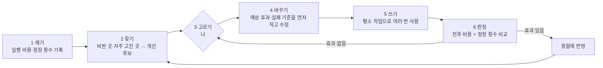

# research-efficiency 쓰는 법

> 이 스킬로 무엇을 하고, 연구 결과로 스킬·스타일·볼트를 어떻게 고쳐 가는지 사용자 쪽에서 본 설명이다. 회차의 세부 절차는 `SKILL.md`, 지금 아는 것은 `research/knowledge.md` 에 있다.

## 한 줄 요약

연구실은 근거를 재고 개선 후보를 만든다. 나는 어느 후보를 시도할지와 바꿔도 되는지만 정한다.

## 개선 하나가 도는 순환

## 단계별로 누가 무엇을 하나

| 단계 | 누가 | 하는 일 | 장부에 남는 것 |
|---|---|---|---|
| 1 재기 | 연구실 (매 회차, 날마다 23:50 예약 작업) | 스킬 실행 비용과 세션 첫 호출 크기를 기록한다. 세션 원본이 30일 뒤 지워져서 매번 하고, 예약 작업이 모델 없이 날마다 옮겨 둔다 | 측정값(`runs.tsv`, `base.tsv`) |
| 2 찾기 | 연구실 | 가장 비싼 곳, 자주 고친 곳을 재서 "이렇게 바꾸면 이만큼 준다" 는 후보로 만든다 | 사실, 방향 |
| 3 고르기 | 나 | 후보 가운데 시도할 것과 순서를 정한다 | — |
| 4 바꾸기 | 연구실 + 내 승인 | 바꾸기 전에 지금 값, 예상 값, 실패로 볼 기준을 적고 대상을 고친다 | 시도 |
| 5 쓰기 | 나 (평소 작업) | 바꾼 스킬을 평소처럼 쓴다. 실행 기록은 저절로 쌓인다 | — |
| 6 판정 | 연구실 → 나 | 바꾸기 전후를 견준다. 효과가 없으면 되돌릴지 내가 정한다 | 시도 결과, 고친 종합 |
| 회차마다 | 연구실 (도구) | 닫을 때 그 회차의 결과 수치를 적고, 보고문을 남기고, 볼트 사본을 다시 만든다 | 결과 수치(`snapshots.tsv`), 보고문(`reports/`), 볼트 `research/efficiency/` |

## 장부의 말

| 말 | 뜻 | 예 |
|---|---|---|
| 회차 | 이 스킬을 한 번 불러서 하는 연구. 초점 하나만 다룬다 | 5회차 |
| 사실 (F-번호) | 재서 확인한 것 하나 | 긴 대화에서 부르면 호출마다 그 맥락을 다시 읽는다 |
| 방향 (D-번호) | 아직 확인하지 않은 가설이나 해 볼 수 있는 개선 | 기록 서브에이전트의 생각 토큰과 모델을 낮춘다 |
| 시도 (A-번호) | 실제로 바꾼 것. 바꾸기 전에 예측과 실패 기준을 적고, 쓰면서 쌓인 실행으로 판정한다 | 기록 스킬을 본 대화와 서브에이전트로 나눴다 |
| 종합 (`knowledge.md`) | 지금 아는 것을 근거 번호와 함께 모은 글. 회차를 시작할 때 이것만 읽는다 | — |

## 개선 대상별로 바꾸는 길

| 대상 | 연구실이 주는 근거 | 바꾸는 길 |
|---|---|---|
| 스킬 구조 | 스킬별 한 번 비용, 실행 안에서 어느 단계가 비싼지 | 스킬 파일 수정 → iCloud·개인 저장소 백업 |
| 피드백 스타일 구조 (style 폴더) | 세션마다 읽는 비용, 지시가 지켜지지 않아 정정받은 횟수 | `collect-feedback` 으로만 |
| 볼트 구조 (record, daily) | 기록 한 번 비용, 자주 읽히는 노트 | `record-obsidian`. 그 대화에서 정하지 못하면 볼트 `proposals.md` 에 남긴다 |
| 늘 실리는 맥락 (CLAUDE.md, 플러그인, 훅) | 세션 첫 호출의 구성 | 직접 수정 |

어느 쪽이든 바꾸는 결정은 내가 한다. 연구실이 스스로 하는 것은 재기, 사실 쓰기, 근거를 잃은 방향 닫기, 종합 고치기, 자기 도구의 결함 고치기다.

## 방향을 정할 때 먼저 볼 원칙

- 비용은 스킬 본문보다 어디서, 언제 부르는가가 크다. 긴 대화에서 부르면 호출마다 그 맥락을 다시 읽고, 쉬었다 부르면 맥락을 캐시에 다시 쓴다(F-03, F-04). 그래서 개선의 일부는 파일 수정이 아니라 부르는 습관이다.
- 늘 실리는 맥락은 줄여도 값 차이가 작다(F-08, D-03).
- 가장 비싼 스킬부터 본다. 스킬별 합과 중앙값은 회차 시작 현황의 '스킬별 한 번 값' 에 나온다.
- 최신 수치와 결론은 `research/knowledge.md` 에 있다.

## 다음에 무엇을 할지 보는 곳

| 보는 곳 | 알 수 있는 것 |
|---|---|
| 회차 시작 현황의 '지난 회차' | 지난 회차가 넘긴 다음에 할 일 |
| 현황의 '판정 대기 시도' | 판정을 기다리는 변경과 쌓인 실행 수 |
| 현황의 '열린 방향' | 아직 시도하지 않은 후보와 우선 |
| 볼트 `research/efficiency/` | 회차 일지(그 회차 보고문 포함), 회차마다 바뀐 결과 표(`trend`), 달별 측정, 종합. Obsidian 에서 링크로 따라간다 |
| 장부 `snapshots.tsv` | 회차마다의 결과 수치 원본(긴 형식 TSV). 나중에 그래프나 계산으로 볼 때 쓴다 |
| 회차 끝 보고의 '사용자가 정할 것' | 내가 답해야 할 것. 항목마다 하는 일 한 줄, 개선 대상, 선택지와 추천이 붙는다 |

## 운영 방법

- 새 세션에서 `/research-efficiency` 를 부른다. 긴 대화에서 부르면 첫 호출부터 비싸다(F-03).
- 주 1~2회, 한 회차에 초점 하나. 다룰 초점을 정해 주면 그것부터, 아니면 연구실이 현황에서 고른다.
- 재기만 하는 날은 측정 회차로 짧게 닫는다. 실행을 옮기는 것은 예약 작업이 날마다 하므로 그것 때문에 작업 중인 세션에서 부를 필요는 없다.
- 연구 회차는 daily history 에 쓰지 않는다. 일지와 결정은 볼트 `research/` 에 도구가 남긴다.
- 5회차마다 종합 회차에서 쌓인 것을 정리하고 우선순위를 함께 다시 정한다.
- 내가 할 일은 회차 끝 보고의 '사용자가 정할 것' 에 답하는 것뿐이다.
